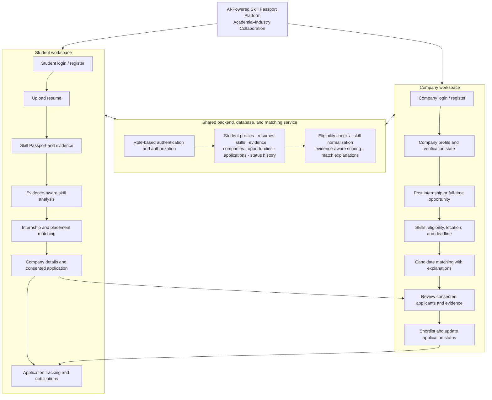

# Proofolio architecture and MVP plan

## Product target

The initial target is a responsive web application. This follows the web-first default in the project brief and fits the current browser-based prototype. Student and recruiter workspaces share a visual system but enforce separate permissions in the API. Company verification is an explicit review state; it is never implied by registration.

## Recommended production architecture

```text
Browser (React + TypeScript + Vite)
        │ HTTPS / JSON REST API
        ▼
FastAPI application ── MySQL (relational records)
        │                       │
        ├── Resume parser       └── migrations (Alembic)
        ├── Matching service
        └── Private object storage (resume and evidence files)
```

- **Frontend:** React, TypeScript, Vite, Tailwind CSS, and accessible reusable components. Keep student, recruiter, and admin routes in separate modules.
- **API:** Python/FastAPI with Pydantic request and response schemas. Keep authentication, profiles, files, opportunities, applications, notifications, and matching in separate routers/services.
- **Database:** MySQL with foreign keys, uniqueness constraints, indexes, and Alembic migrations. Never treat browser storage as the system of record.
- **Authentication:** Password hashes using Argon2id or a trusted identity provider. Use secure, HTTP-only cookies for browser sessions; enforce role and ownership checks in every protected API operation.
- **Files:** Private object storage in production. The database stores opaque storage keys and metadata, not public file paths. The existing local parser processes uploads in memory.
- **Matching:** A versioned deterministic service first. Check mandatory eligibility before scoring skill, project, experience, and evidence coverage. Explanations list supported, missing, and uncertain requirements. A future model can be added behind the same interface; it must not invent claims or decide hiring outcomes.
- **Current prototype:** `index.html`, `styles.css`, and `app.js` provide the responsive UI; `server.py` serves it and the in-memory resume parsing endpoint; `resume_parser.py` extracts text and conservative skill mentions. This implementation is a demo, not the production stack above. Demo listings and profiles are synthetic; edits and applications are browser-local, while uploads are not persisted.

## Complete system workflow



The current local MVP covers role selection, registration, session handling, reviewed resume claims, project-backed Skill Passport entries, opportunity publishing, consent-based applications, candidate matching, applicant review, and application status updates. Resume parsing and matching remain explicitly labelled as deterministic features; no model-generated qualification or hiring decision is claimed.

## Suggested production project structure

```text
proofolio/
├── frontend/
│   ├── src/app/                 # routes, providers, layout
│   ├── src/features/            # auth, passport, jobs, applications, recruiter
│   ├── src/components/          # shared accessible UI
│   ├── src/lib/                 # API client, validation, utilities
│   └── tests/
├── backend/
│   ├── app/api/v1/              # versioned route handlers
│   ├── app/core/                # settings, auth, authorization
│   ├── app/models/              # SQLAlchemy entities
│   ├── app/schemas/             # Pydantic contracts
│   ├── app/services/            # domain workflows and matching
│   ├── app/storage/             # private file storage interface
│   ├── migrations/              # Alembic revisions
│   └── tests/
├── docs/architecture.md
├── infra/                       # deployment configuration, no secrets
├── .env.example
└── README.md
```

The current prototype remains at the repository root during the MVP transition. Move it into the production structure only when the corresponding frontend/API replacement is ready.

## Data model and relationships

All IDs are opaque UUIDs; timestamps are UTC. Use `created_at` and `updated_at` where records are mutable. Store enums as constrained strings or lookup tables, and add indexes for common ownership, status, and search filters.

| Entity | Main fields and relationships |
| --- | --- |
| `users` | `id`, normalized unique `email`, `password_hash`/identity reference, `role` (`student`, `recruiter`, `admin`), `status`, timestamps. One user owns one role-specific profile. |
| `student_profiles` | `user_id` unique FK, name, institution, degree, branch, academic year, graduation year, career interests, privacy settings, profile fields. |
| `companies` | `owner_user_id` FK, name, industry, description, website, location, size, official contact, `verification_status`, reviewer and timestamps. A recruiter account belongs to one company initially; later multi-recruiter membership can use `company_members`. |
| `resumes` | `student_id` FK, private `storage_key`, original filename, content type, byte size, checksum, parse status, extracted structured data JSON, timestamps. Never store the uploaded file in a public directory. |
| `skills` | normalized unique `name`, category. Shared catalogue. |
| `student_skills` | composite/unique student and skill FKs, source (`self_reported`, `resume`, `project`), optional proficiency, claim status. This is a claim record, not proof of verification. |
| `projects` | `student_id` FK, title, description, role, outcomes, repository/deployment URLs, timestamps. |
| `evidence` | `student_id` FK, optional `skill_id` and/or `project_id` FKs, type, description, private storage key or submitted URL, source, review status (`unreviewed`, `reviewed`, `independently_verified`), reviewer and timestamps. A certificate/link alone never sets independent verification. |
| `opportunities` | `company_id` FK, title, type (`internship`, `full_time`), description, responsibilities, eligibility, branches, graduation years, experience, location, work mode, compensation, openings, deadline, status (`draft`, `published`, `closed`, `archived`), timestamps. |
| `opportunity_skills` | opportunity and skill FKs, requirement kind (`required`, `preferred`, `soft_skill`); unique pair and kind. |
| `applications` | `student_id`, `opportunity_id`, selected `resume_id`, consent snapshot, submitted details, current status, timestamps. Unique `(student_id, opportunity_id)` prevents duplicates. |
| `application_status_history` | application FK, previous/new status, actor user FK, timestamp, optional note. Append-only audit trail. |
| `match_results` | student and opportunity FKs, score, eligibility, factor breakdown JSON, explanation, algorithm version, created timestamp. Recomputable; not the source of truth for eligibility. |
| `notifications` | recipient user FK, type, message, optional related entity, read timestamp, created timestamp. |

Core relationships: a user has one student profile or recruiter-owned company; a student owns resumes, skills, projects, and evidence; a company owns opportunities; opportunities have normalized skill requirements; applications connect students to opportunities; each application has status history; match results connect a student/opportunity pair; notifications belong to users. Add `ON DELETE` behavior deliberately: cascade disposable child data, but retain audit history or anonymize it where retention rules require.

## API surface (planned, `/api/v1`)

All request bodies are validated; responses omit password hashes and private storage keys. Paginated list endpoints use `limit` and `cursor` (or a documented page scheme). Return consistent errors with a safe message and request ID.

| Method and path | Access | Purpose |
| --- | --- | --- |
| `POST /auth/register/student`, `POST /auth/register/company` | Public | Create a role-specific account and profile draft. |
| `POST /auth/login`, `POST /auth/logout`, `GET /auth/session` | Public / signed-in | Create, end, and inspect a session. |
| `POST /auth/password-reset/request`, `POST /auth/password-reset/confirm` | Public | Password reset flow when email delivery is configured. |
| `GET/PATCH /students/me` | Student | Read/update own profile and privacy settings. |
| `GET/POST/PATCH/DELETE /students/me/skills`, `/students/me/projects`, `/students/me/evidence` | Student | Manage own passport claims and evidence. |
| `POST /students/me/resumes`, `GET /students/me/resumes`, `GET/DELETE /students/me/resumes/{id}` | Student | Upload, list, download through authorized streaming, or delete own resumes. |
| `POST /students/me/resumes/{id}/parse`, `PATCH /students/me/resumes/{id}/extraction` | Student | Parse and review/correct extracted claims before adding them to the passport. |
| `GET /students/me/analysis`, `GET /students/me/matches` | Student | Explain skill gaps and retrieve recommendations. |
| `GET /opportunities`, `GET /opportunities/{id}` | Public or signed-in | Search published, non-expired listings and view details. Private recruiter fields are excluded. |
| `GET/POST /students/me/saved-opportunities/{opportunity_id}` | Student | Save or unsave a listing. |
| `POST /opportunities/{id}/applications`, `GET /students/me/applications`, `POST /students/me/applications/{id}/withdraw` | Student | Consent-based application, tracking, and withdrawal. Reject closed/expired listings and duplicate submissions. |
| `GET/PATCH /companies/me` | Recruiter, company scoped | View/update the recruiter's own company profile. |
| `GET/POST /companies/me/opportunities`, `GET/PATCH /companies/me/opportunities/{id}`, `POST /companies/me/opportunities/{id}/publish`, `POST /companies/me/opportunities/{id}/close` | Recruiter, company scoped | Draft, edit, publish, and close owned opportunities. Publishing requires valid fields and the configured verification policy. |
| `GET /companies/me/opportunities/{id}/candidates` | Recruiter, company scoped | View consent-eligible candidate matches with factor explanations and privacy-filtered profile data. |
| `GET /companies/me/applications`, `GET /companies/me/applications/{id}`, `PATCH /companies/me/applications/{id}/status` | Recruiter, company scoped | Review applicants and append status history. |
| `GET /students/me/notifications`, `POST /students/me/notifications/{id}/read` | Signed-in owner | List and mark own notifications read; mirror for company recruiters. |
| `GET /admin/companies/pending`, `PATCH /admin/companies/{id}/verification` | Admin | Review company verification with an audit record. |

Access rules apply on the server: students can access only their records; recruiters can access only their company's records and only the student information needed for consented applications or permitted matching; admin routes require the admin role. File downloads use authorization checks and short-lived access, never guessable public URLs.

## User workflows

**Student:** choose Student → register/sign in → complete academic profile → upload a supported resume → review/correct extracted details and skill mentions → add projects and evidence → inspect skill analysis and its sources → browse separate internship/full-time listings → inspect eligibility and match explanation → save or apply with explicit sharing consent → track status and notifications → withdraw if desired.

**Company/recruiter:** choose Company → register/sign in → complete company profile → wait for a clearly labelled verification state where required → create and preview a draft opportunity → publish valid requirements → inspect eligible candidate matches and evidence explanations → review consented applications → update statuses (each change recorded) → close/archive the listing.

**Admin (later MVP support):** review company evidence and verification requests; record decisions and audit history. Admin access is isolated from student/recruiter views.

## Phase 2 prototype status

Already present in the current prototype: responsive role-specific demo workspaces; in-memory PDF/DOCX/TXT/Markdown resume extraction with review; evidence and resume-claim separation; a skill passport preview; rule-based role/opportunity matching; synthetic internship/full-time listings; demo opportunity creation; consent-gated sample application; recruiter candidate matching and status updates. The matching is deterministic, not an LLM. Synthetic profiles/listings are labelled as demo data.

Not present yet: real registration or password reset; persistent relational records; production role/tenant authorization; durable private file storage; company verification; real notifications; actual public sharing links; real vacancies; production AI. Do not present these as working features until implemented and verified.

## MVP acceptance criteria

1. A student and recruiter can register, sign in, sign out, and reach only their role's permitted screens; API checks enforce role and record ownership.
2. A student can maintain academic details, skills, projects, and evidence; evidence status distinguishes self-reported, evidence-linked, and independently verified claims.
3. A student can upload a size/type-limited resume to private storage, review/correct extraction, and choose what to retain. Untrusted document text is treated only as data.
4. A recruiter can maintain a company profile and draft, preview, publish, edit, and close internship and full-time listings; verification state is explicit.
5. Students can search/filter published opportunities, see eligibility and explainable matches, and apply with explicit consent. Expired/closed listings reject applications and the database prevents duplicates.
6. Recruiters see only their company's applicants and permitted candidate details; status changes are timestamped and visible to the student.
7. Matching explains requirement coverage and uncertainty, does not count resume-only claims as demonstrated evidence, and never claims an AI model is used when only deterministic rules run.
8. Empty, loading, validation, success, and error states are usable on mobile and desktop; secrets and private files are not exposed in frontend assets or repository configuration.

## Next implementation sequence

1. Keep the current Phase 2 demo usable and identify its demo-only boundaries (done in this document and the README).
2. Add student/company role-selection entry and clearly separated registration UI only when it can be connected to a real account API; avoid collecting passwords into browser storage.
3. Build FastAPI/MySQL authentication and migrations, then replace local-storage workflows in vertical slices: profiles/passport, opportunities, applications/status history, and notifications.
4. Move resume parsing behind the API and add private storage plus reviewed extraction persistence.
5. Retain the deterministic matching interface, persist versioned results, and evaluate with representative cases before introducing a model.
